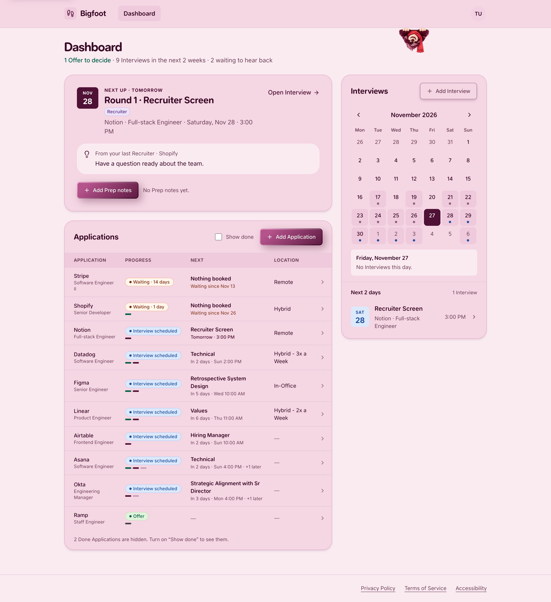

# Bigfoot

A job search tracker. Job hunting is chasing Bigfoot: Bigfoot keeps every Application in one place until you find yours, so nothing lives in a spreadsheet or a forgotten email thread.


## Status

Bigfoot is an early proof of concept, built as a side project. Sign in with Google, add the roles you've applied to, log their Interviews, and follow them on a dashboard with two sections: **Interviews**, a calendar and agenda of what's coming, and **Applications**, a table ordered by what each one is waiting on.



## Use the API from a terminal

A script can read and change your Applications and Interviews without a browser, for example a cron job that adds an Interview when one appears in your calendar.

1. Sign in, open the **Account** page and create an **Access token**. Copy the secret straight away: Bigfoot shows it once.
2. Send it as a bearer token:

   ```bash
   export BIGFOOT_TOKEN="bigfoot_…"
   export BIGFOOT_API="https://bigfoot-api.vercel.app"

   # List your Applications, each with its Interviews
   curl -H "Authorization: Bearer $BIGFOOT_TOKEN" "$BIGFOOT_API/applications"

   # Add an Application
   curl -X POST "$BIGFOOT_API/applications" \
     -H "Authorization: Bearer $BIGFOOT_TOKEN" -H "Content-Type: application/json" \
     -d '{"company": "Northwind Robotics", "title": "Frontend Engineer"}'

   # Add an Interview to it, using the "id" from the response above
   curl -X POST "$BIGFOOT_API/applications/<application id>/interviews" \
     -H "Authorization: Bearer $BIGFOOT_TOKEN" -H "Content-Type: application/json" \
     -d '{"category": "technical", "title": "Pairing exercise", "at": "2026-11-20T17:00:00Z",
          "participants": [{"name": "Dana Lee", "role": "Staff Engineer"}]}'
   ```

Every route and field is in [`api/openapi.json`](api/openapi.json). Treat a token like a password: it can do anything to your Applications and Interviews, though not to your account or tokens. It expires after a year, and you can revoke it on the Account page.

## Tech stack

- [Next.js 16](https://nextjs.org) and React 19, with [Auth.js](https://authjs.dev) Google sign-in and [Tailwind CSS 4](https://tailwindcss.com)
- [FastAPI](https://fastapi.tiangolo.com) (Python, in [`api/`](api)) on [Supabase](https://supabase.com) Postgres. The browser never calls it; the Next.js server does ([ADR 0001](docs/adr/0001-fastapi-behind-nextjs-with-authjs.md)), and so can a job seeker's scripts ([ADR 0003](docs/adr/0003-access-tokens-open-fastapi-to-scripts.md))

## Run it locally

You need Node.js 24, [uv](https://docs.astral.sh/uv/getting-started/installation/), a Google account, and a Supabase project.

1. Install dependencies and copy the environment file:

   ```bash
   git clone https://github.com/wisamjs/bigfoot.git && cd bigfoot
   npm install
   (cd api && uv sync)
   cp .env.example .env.local
   ```

2. Fill in `.env.local`:
   - `AUTH_SECRET` and `API_SECRET`: each from `openssl rand -base64 33`.
   - `AUTH_GOOGLE_ID` and `AUTH_GOOGLE_SECRET`: create an **OAuth client ID** of type **Web application** in [Google Cloud Console → Credentials](https://console.cloud.google.com/apis/credentials), with `http://localhost:3300/api/auth/callback/google` as a redirect URI. To skip Google, see [Contributing](docs/contributing.md#skip-google-sign-in).
   - `DATABASE_URL`: in the Supabase dashboard, **Connect → Session pooler**, with your database password. Apply [`supabase/migrations`](supabase/migrations) to the project (SQL editor or `supabase db push`).

3. Start the API and the dev server in two terminals, then open [http://localhost:3300](http://localhost:3300):

   ```bash
   npm run dev:api
   npm run dev
   ```

## More

- [Contributing](docs/contributing.md): checks, CI, test data, the local API docs
- Runbooks: [database](docs/runbooks/database.md) (the two Supabase projects, migrations, backups) and [Vercel](docs/runbooks/vercel.md) (only `main` deploys)
- [`GLOSSARY.md`](GLOSSARY.md): the product's terms
- [`docs/adr/`](docs/adr): design decisions
- [`AGENTS.md`](AGENTS.md): Bigfoot is built by AI coding agents working from these rules

## License

[MIT](LICENSE) © 2026 Wisam Zaghal
