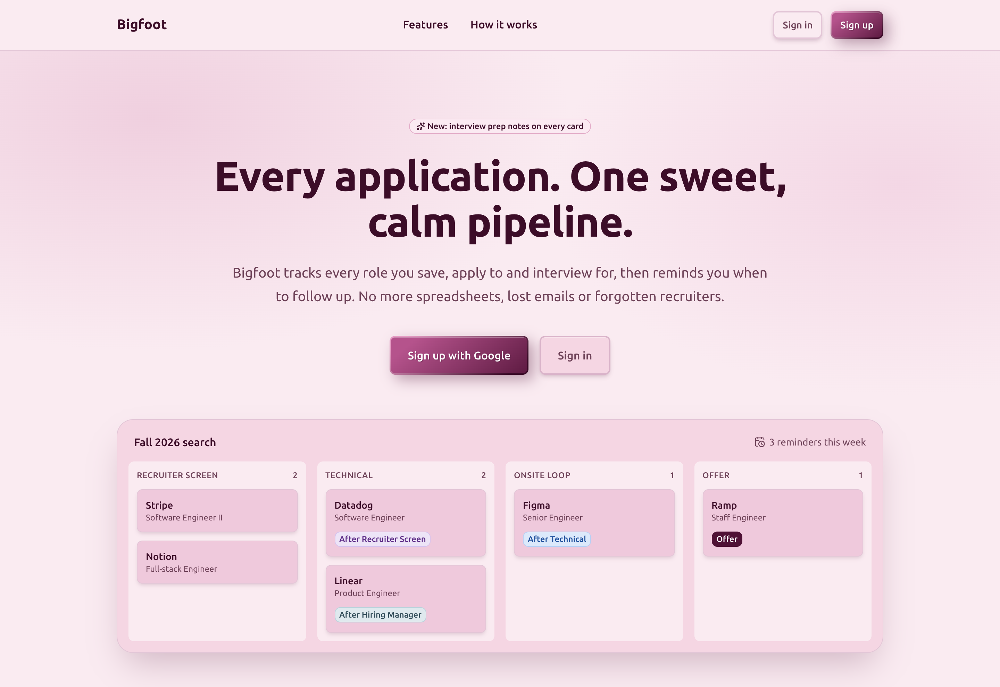

# Bigfoot

A job search tracker. Job hunting is chasing Bigfoot: Bigfoot keeps every Application in one Pipeline until you find yours, so nothing lives in a spreadsheet or a forgotten email thread.



## Status

Bigfoot is an early proof of concept, built as a side project.

**Works today**

- Landing page
- Sign in with Google
- A dashboard with stats, the Pipeline board (grouped by next Interview), upcoming Interviews, and a table of all your Applications
- A few Sample Applications for new job seekers, so the dashboard shows how Bigfoot works before they add their own
- Adding, editing and deleting Applications right in the table: text fields save when you leave them, dropdowns save when you pick a value

**Not built yet**

These features appear on the landing page but are still planned:

- Moving Applications on the board by drag and drop
- Interview prep notes
- Follow-up reminders
- Contacts and referrals
- Search analytics
- One-click capture from a job link


## Tech stack

- [Next.js 16](https://nextjs.org) (App Router, Cache Components) and React 19
- [Auth.js](https://authjs.dev) with Google sign-in and encrypted cookie sessions
- [Tailwind CSS 4](https://tailwindcss.com), with every design token defined in [`src/app/globals.css`](src/app/globals.css)
- [TanStack Table](https://tanstack.com/table) for the editable Applications table
- [FastAPI](https://fastapi.tiangolo.com) (Python, in [`api/`](api)) serving Applications from [Supabase](https://supabase.com) Postgres. The browser never calls it: the Next.js server does, with a short-lived token naming the signed-in user ([ADR 0001](docs/adr/0001-fastapi-behind-nextjs-with-authjs.md))
- TypeScript and Python

## Run it locally

You need Node.js 24, [uv](https://docs.astral.sh/uv/getting-started/installation/), a Google account and a Supabase project.

1. Clone the repo and install dependencies:

   ```bash
   git clone https://github.com/wisamjs/bigfoot.git
   cd bigfoot
   npm install
   cd api && uv sync && cd ..
   ```

2. Copy the example environment file:

   ```bash
   cp .env.example .env.local
   ```

3. Generate a session secret and paste it into `AUTH_SECRET` in `.env.local`:

   ```bash
   openssl rand -base64 33
   ```

4. Create a Google OAuth client:
   1. Open [Google Cloud Console → Credentials](https://console.cloud.google.com/apis/credentials).
   2. Create an **OAuth client ID** of type **Web application**.
   3. Add `http://localhost:3300/api/auth/callback/google` as an authorized redirect URI.
   4. Paste the client ID and secret into `AUTH_GOOGLE_ID` and `AUTH_GOOGLE_SECRET` in `.env.local`.

5. Set up the database:
   1. Apply [`supabase/migrations`](supabase/migrations) to your Supabase project (SQL editor or `supabase db push`).
   2. In the Supabase dashboard, click **Connect → Session pooler**, and paste the URI (with your database password) into `DATABASE_URL` in `.env.local`.
   3. Generate the API secret and paste it into `API_SECRET`:

      ```bash
      openssl rand -base64 33
      ```

6. Start the API and the dev server in two terminals. The dev server always runs on port 3300, which the redirect URI and `npm run smoke` expect:

   ```bash
   npm run dev:api
   npm run dev
   ```

7. Open [http://localhost:3300](http://localhost:3300) and sign in.

### Skip Google sign-in

To see the dashboard without setting up Google (step 4), you only need `AUTH_SECRET` (plus the database and API from steps 5 and 6). Generate a session cookie for a test user:

```bash
node scripts/dev-session.mjs
```

In your browser's developer tools, add a cookie named `authjs.session-token` for `localhost` with that value, then open [http://localhost:3300/dashboard](http://localhost:3300/dashboard).

Like any new job seeker, the test user receives Sample Applications the first time they open the dashboard. For a fuller dashboard, run `node scripts/dev-applications.mjs remove` and then `add` (and `remove` again to empty it).

### Retake the screenshots

With the dev server and API running, `npm run screenshots` retakes the two screenshots in this README.

## Quality checks

| Command | What it checks |
| --- | --- |
| `npm run check` | Types, lint, that components use design tokens instead of raw colours and corner radii, Canadian spelling (cspell), and Vitest |
| `npm run test:api` | API tests (pytest) against the real database, in a throwaway `bigfoot_test` schema (one per run in CI) rebuilt for every test |
| `npm run smoke` | Loads every route signed in and signed out against the running dev server and API (starting either if needed), and fails on any server error |
| `npm run build` | Production build (stop `next dev` first: they share `.next/`) |

[CI](.github/workflows/ci.yml) runs all four on every push and pull request. It needs a `DATABASE_URL` repository secret.

## How it was built

Bigfoot was built with AI coding agents working from the project rules in [`AGENTS.md`](AGENTS.md).

[`GLOSSARY.md`](GLOSSARY.md) defines the product's terms (Application, Status, Outcome, Interview, Pipeline).

## License

[MIT](LICENSE) © 2026 Wisam Zaghal
